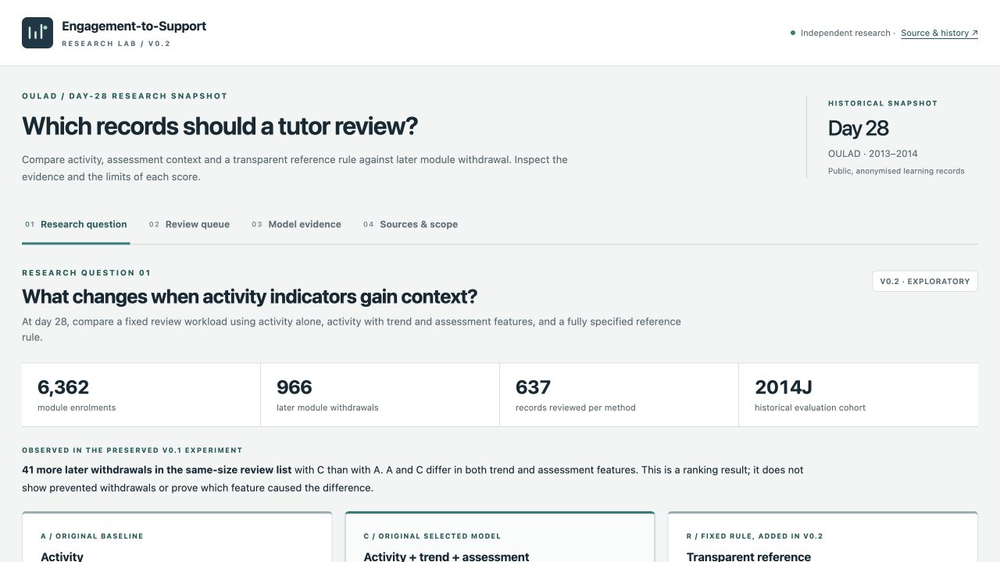

# v0.2 verification and publication status

Checked locally on 13 November 2026, in the existing
`rongsenzhang/engagement-to-support-lab` checkout, branch
`research/v0.2-reference-diagnosis`. Base: `fe0fcaf91bddb552ddf92ec3b5c9d8a8c592f32f`.
This file distinguishes executed checks from publication. A second review on the
same date completed the previously unavailable real-browser checks and established
authenticated Git access. Remote publication is tracked by the branch's PR and
GitHub Actions; it is not established by local checks alone.

## Executed checks

| Check | Observed result | Scope |
|---|---|---|
| Python test suite | **34 passed** (15 original, 19 added) | Data boundaries, scoring, joins, outcome independence, example rules, frozen files and artifact/provenance agreement |
| Node application tests | **11 passed** | Actual scripts and payloads in a simulated DOM: routes, index units, filters, exports, outcome visibility, cases and malformed-overlay fallback |
| Reference rebuild | Passed; no diff in committed experiment artifacts or overlays | Deterministic regeneration, including manifest, from the separately committed protocol and fixed inputs |
| v0.1 preservation | Ten SHA-256 comparisons passed | Seven original artifacts, original browser data, pipeline and original protocol remain byte-identical |
| JavaScript syntax | All three application scripts passed | `app.js`, `data.js`, `reference-data.js` |
| Python compilation | Passed using a writable local bytecode-cache directory | Python source, tests and entry points |
| Offline packaging | Passed | HTML and source ZIP generated; three inline scripts parse, reference overlay is included, no external JavaScript/CSS application assets remain |
| Whitespace/error check | `git diff --check` passed | Tracked changes |
| Real-browser review | Passed at 1280 × 720 and 390 × 844 | Four routes; case selection; R arithmetic; model/module filters; record selection; hidden/revealed outcomes; CSV download |
| Independent arithmetic review | All 6,362 R scores and five methods' metrics matched | Separate standard-library reconstruction of top-637 counts, AP, ROC-AUC, applicable Brier scores and four case-selection rules |

Local environment: Python 3.9.6 with `requirements.txt`, Node 24.22.1. CI is
configured for Python 3.11 and Node 24. Inspect the PR checks for remote CI results.
The default macOS Python cache path was outside the writable workspace; compilation
was rerun successfully with `-X pycache_prefix=dist/pycache`. This changed no source
or model specification.

The simulated-DOM tests exposed a null-record crash in an invalid reference
overlay. The UI guard was corrected, and all eleven tests passed afterwards.
Invalid or missing overlays retain the original results without fabricating an R
score. Full dataset checks remain in the Python tests and provenance manifest.

## Real-browser review completed on 13 November 2026

The browser rendered the actual committed JavaScript and data from a local HTTP
server. The overview, review queue, model evidence and sources views were exercised.
The no-assessment case correctly omitted the assessment term and reconstructed
its R index as 7.14. Selecting R and module EEE produced 970 eligible enrolments
and a 97-record list at 10% capacity, with index units rather than probabilities.
The downloaded CSV contained 97 records and no later-outcome column while the
outcome toggle was off. Enabling the toggle displayed the retrospective column
and cohort metrics. Record selection worked in the mobile-width queue.

Overview, queue and evidence layouts had no document-level horizontal overflow
at 390 pixels; the desktop overview also fit its 1280-pixel viewport. No browser
console errors or warnings were observed. These are targeted smoke checks, not
an exhaustive device/browser compatibility assessment.



[Mobile-width overview screenshot](images/v0.2/mobile-overview.jpg)

The independent review additionally verified all manifest hashes against actual
files, and compared the ten frozen files with their original Git blobs. It found
no blocking scoring, frontend, packaging or CI defect. Targeted live checks of
the official KTP vacancy and Kortext product sources supported the material
product-diagnosis claims. Reviews were AI-assisted, not external peer review.

## Limits of this verification

- An earlier browser-launch failure was resolved in the second review. Desktop
  and mobile-width browser checks are now complete. No physical mobile-device,
  screen-reader or comprehensive accessibility test is claimed.
- Node tests use a small simulated DOM, not a browser layout engine. They verify
  generated content and event-driven logic, not visual correctness.
- None of these software checks validates predictive benefit, intervention
  effectiveness, proprietary parity or real tutor usefulness.

## GitHub and deployment status

The existing remote `main` and v0.1.0 release were read and checked before work.
The protocol was committed locally before the new reference evaluation. Source,
research, generated artifacts and application changes are maintained on the
feature branch; the released baseline is preserved.

The GitHub connector rejected remote-branch creation with HTTP 403
`Resource not accessible by integration`. The second review confirmed that
limitation, then the repository owner completed standard GitHub CLI authorization.
The local GitHub session now authenticates as `rongsenzhang`, with credentials
held in the operating-system keyring. No credentials are part of this repository.

The publication sequence is: push the existing branch, open its PR against
`main`, inspect GitHub Actions, merge, verify Pages, and publish a release. Consult
the PR and Actions for the actual completed steps. A pushed feature branch does
not update the live website, and local browser review does not verify deployment.

When merging, use **Create a merge commit**, with no squash or
rebase. Preserve the protocol-before-evaluation history and its commit identity;
rewriting it would change the generated manifest and fail the deployment check.
The PR description is
in [pr_v0.2.md](pr_v0.2.md); progress belongs in
[Issue #1](https://github.com/rongsenzhang/engagement-to-support-lab/issues/1).
Rollback instructions remain in [CONTRIBUTING.md](../CONTRIBUTING.md).

## Re-run locally

```sh
python -m pytest -q tests
python build_reference.py
git diff --exit-code -- artifacts web/data.js web/reference-data.js
python -m compileall -q src tests download_data.py run_demo.py package_demo.py build_reference.py
node --check web/app.js
node --check web/data.js
node --check web/reference-data.js
node --test tests/test_web.cjs
python package_demo.py
git diff --check
```

Use a full Git checkout for protocol provenance. On a restricted macOS setup,
add `-X pycache_prefix=dist/pycache` to the compilation command. Tests and packaging
use the committed public artifacts; no institutional data or raw-data download is
required.
