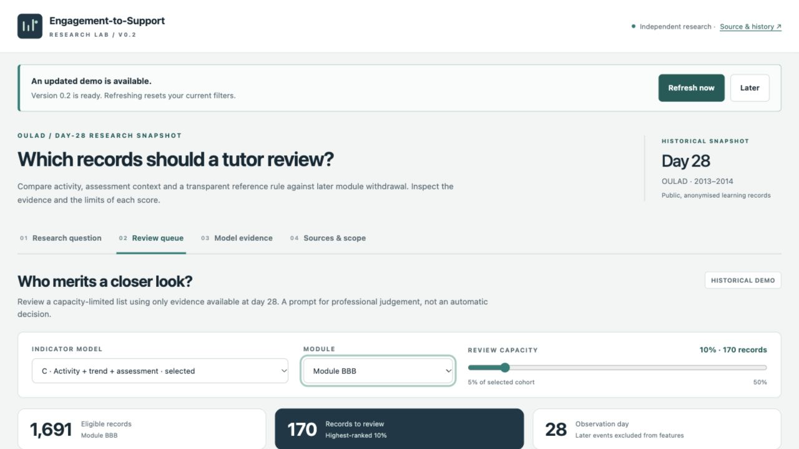
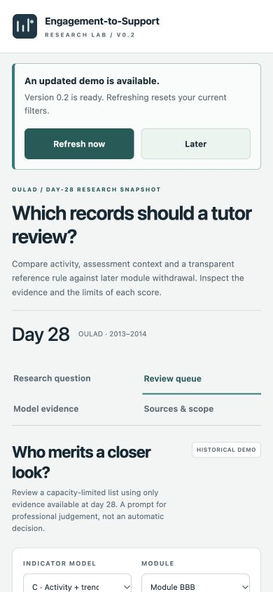

# Deployment maintenance verification — 15 November 2026

Scope: issue #4, branch `fix/versioned-deployment`, based on main
`c648e192fa9dd629cb70ff4fb61c11296e506ca1`. This changes publication and update
handling; research data, predictions, reference results and the default model
remain unchanged. Development, independent review and checks used AI assistance.

## Checks performed locally

- Full Python suite: **96 passed**. Tests cover the existing research contracts, deterministic builds, safe
  output handling, offline packaging, historical resource retention and real HTTP
  publication checks. Stale HTML/manifests, missing or altered resources, and
  truncated responses fail verification; transient failures can recover on retry.
- Node's built-in runner passes 25 tests: 11 existing application checks and 14
  update-watcher checks. These use simulated DOM/network/timer fixtures, including
  unchanged/new/rollback builds, Later, refresh URL, malformed responses, offline,
  hidden tabs, focus throttling and timeout recovery.
- Rebuilding the reference overlay leaves `artifacts/`, `web/data.js` and
  `web/reference-data.js` unchanged. No raw-data download or model retraining was
  performed. Python/JavaScript syntax checks and standalone packaging succeed.
- The generated site passes the deployment checker through a real local HTTP
  server. This exercises the same checker used after Pages deployment.

## Real-browser update transition

Checked through the in-app browser at desktop 1280 × 720 and mobile 390 × 844.
These are responsive browser checks, not a physical-phone or screen-reader audit.

1. Loaded a built site with `?preview=versioning#queue` and selected Module BBB.
2. Rebuilt the served site with a different **synthetic test revision** while the
   original tab remained open. Within its polling cycle the update notice appeared;
   Module BBB and the existing view remained selected, with no forced navigation.
3. Clicked Later: the notice disappeared and Module BBB remained selected.
4. Served another synthetic revision: a new notice appeared despite the earlier
   dismissal. At mobile width the page and viewport both measured 390 pixels,
   with no horizontal overflow; both buttons remained visible.
5. Clicked Refresh now: the URL retained `preview=versioning` and `#queue`, gained
   the new build ID, and the HTML metadata matched that served build. The notice
   was hidden and in-memory filters reset as the notice explains.
6. Rebuilt back to the first test build: the open newer tab also prompted for that
   rollback. Restored the normal viewport after the check.

Synthetic revisions were only local test inputs; they are not Git commits or
published releases. No production Pages deployment is claimed by these checks.
The post-deployment check can run on the public site only after this PR reaches
main. A successful PR check is evidence of build/test behavior, not publication.

## Recovery and limits

The independently reviewed HTTP checker initially missed truncated HTTP bodies:
`IncompleteRead` bypassed failure-report writing. It now catches `HTTPException`;
two real-server tests verify retained diagnostics and recovery on a second attempt.

Legacy pages loaded before the watcher exists need one manual refresh. Downloaded
standalone copies do not auto-update. A complete revert of this infrastructure
also removes its watcher endpoint and publication checks; verify that rollback
manually. Details and the pre-maintenance commit are retained in
[deployment.md](deployment.md). No force push or tag movement is part of this work.
